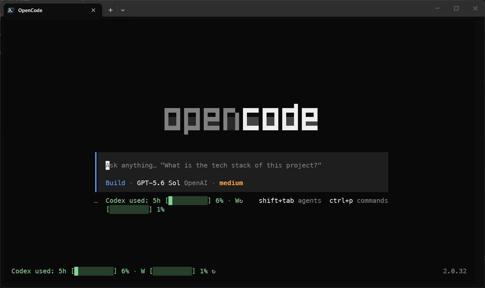

# OpenCode Codex Quota

An unofficial OpenCode V2 TUI plugin showing **Codex quota used** for the 5-hour and weekly windows. At startup it displays once in the home footer; in active sessions it displays in the prompt footer, never both. Click the quota text to cycle compact used percentages → graphical used progress bars → reset timing → compact. The choice persists across OpenCode restarts and TUI instances. By default, the display is compact. The **Cycle Codex quota display** palette command (`codex-quota.toggle-display`) cycles the same views from the keyboard. Click the separate `↻` beside the text to force a refresh in place without changing the view or opening a dialog (`⟳` indicates a request in progress). Press `/quota` to force a refresh and inspect the plan, used percentages, and full reset details.

```text
Codex used: 5h 52% · Week 37%  ↻
(click quota text)
Codex used: 5h [█████░░░░░] 52% · W [████░░░░░░] 37%  ↻
(click quota text again)
Codex resets: 5h in 2h 1m · W in 4d 16h  ↻
(click quota text again returns to compact; click ↻ to refresh current view)

/quota
Plan: plus
5h: 52% used (resets in 2h 1m)
Week: 37% used (resets in 4d 16h)
```



## Requirements

- OpenCode V2 with CLI plugin support.
- An active **OpenAI browser OAuth** connection in OpenCode on the connected server (API keys cannot read subscription quota).
- [Bun](https://bun.sh/) to install dependencies and run development checks.

## Install

Clone the repository and install its dependencies:

```sh
git clone https://github.com/guypritchard/opencode-codex-quota.git
cd opencode-codex-quota
bun install
```

Add the cloned directory as a server plugin in global `~/.config/opencode/opencode.json(c)` (on Windows, `%USERPROFILE%\.config\opencode\opencode.jsonc`). Preserve existing entries:

```json
{
  "$schema": "https://opencode.ai/config.json",
  "plugins": [
    "/absolute/path/to/opencode-codex-quota"
  ]
}
```

On Windows the package path can be written as `"C:/path/to/opencode-codex-quota"`. OpenCode loads both server and TUI parts from this entry. The TUI connects to the server's internal `codex-quota.v1` RPC. For remote OpenCode, **the remote server's active OpenAI OAuth** is used, not the terminal's credentials. No URL or separate quota service is needed for ordinary installs.

The server resolves the active connection on every request, uses only the access token and account identifier in the outbound request, and returns only allowlisted plan and normalized 5h/weekly percentages and reset timing. Refresh tokens are never used; access tokens, account identifiers, upstream bodies, and error details never cross the RPC. Successful responses are cached on the server for 120 seconds, and concurrent refreshes share a request. OpenCode owns OAuth refresh. The server makes a bounded, timed request only to the fixed upstream usage endpoint; an upstream HTML challenge is reported as blocked, not bypassed.

### Optional HTTP override

If you choose to use your own normalized quota service instead, set `OPENCODE_CODEX_QUOTA_URL=https://quota.example.com/api/quota` in the TUI environment or configure an explicit `endpoint` (and optional `pollIntervalMs`) in the plugin options. An explicit endpoint wins over the environment variable; otherwise local RPC is the default. An invalid explicit endpoint is a configuration error and never falls back. There is **no automatic HTTP/NAS fallback**. Endpoints must be HTTP(S) URLs without embedded credentials. `pollIntervalMs` defaults to 120000 (2 minutes), and values below 10000 are clamped to 10000 ms. Protect your service and avoid secrets in the URL.

An initial request runs when the TUI starts; later requests poll every two minutes without overlapping. The latest successful quota is kept in memory for the current TUI process; both `↻` and `/quota` force an RPC refresh (or add `force=1` to an optional HTTP endpoint). The icon updates the footer without a success dialog; `/quota` displays details. Failed manual refreshes show a safe error toast. If unavailable, the footer shows `Codex unavailable` until another poll succeeds. HTTP override requests time out after 10 seconds; server upstream requests after about 15 seconds.

## Optional HTTP endpoint response

Return JSON with `ok: true` and `usage.rate_limit.primary_window` (5h) and/or `secondary_window` (Week). The plugin displays used percentages from `used_percent`; it accepts `providerUsage.windows` entries with `usedPercent` as a fallback. Reset fields are optional. For example (fictional values):

```json
{
  "ok": true,
  "usage": {
    "plan_type": "plus",
    "rate_limit": {
      "primary_window": { "used_percent": 52, "reset_after_seconds": 7283, "reset_at": 1792257458 },
      "secondary_window": { "used_percent": 37, "reset_after_seconds": 403282, "reset_at": 1792653457 }
    }
  }
}
```

The plugin stores only the display-mode preference (`compact`, `bars`, or `resets`) in OpenCode durable plugin storage; it stores no OAuth tokens or API credentials. Reset mode shows countdowns from `reset_after_seconds`, local date/time from `reset_at` when no countdown is supplied (Unix seconds or milliseconds accepted), and `unknown` for windows without reset metadata. If the default source says `NO_CONNECTION`, connect OpenAI OAuth on the connected server. `OAUTH_REQUIRED` means an API key or incomplete OAuth connection is selected. `UPSTREAM_BLOCKED` means the upstream rejected the server's request (e.g. HTML challenge); use a user-controlled supported alternative if available, not a challenge bypass. This project is **unofficial** and is not affiliated with OpenAI or OpenCode. The upstream usage contract can change.

## Develop

```sh
bun install
bun test
bun run typecheck
bun run build
```

The package exports TypeScript source for OpenCode V2 (`.`, `./tui`, and `./rpc`). `bun run build` additionally produces an ignored `dist/` smoke-check artifact; no npm publishing is performed.
